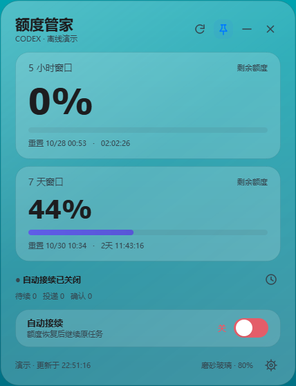

# Codex Quota HUD

A Windows desktop quota monitor with an iOS-inspired frosted-glass interface
and opt-in recovery for Codex conversations interrupted by quota limits.

Windows Codex 额度悬浮窗：查看剩余额度与重置时间，并可手动开启额度恢复后的任务接续。

**Current version: 1.1.2.** Softer glass borders, improved secondary text contrast, and aligned glass layers after resizing.



## Features

- Primary and weekly quota windows, reset countdowns and stale-data indicators.
- Native Windows Composition blur, adjustable transparency and readable fallback.
- Tray, pinning, keyboard shortcuts, optional mouse passthrough and startup companion.
- Automatic continuation is **off at startup** and must be enabled explicitly.
- Local SQLite delivery tracking distinguishes queued, confirmed and uncertain results.

This is an independent community project, not affiliated with OpenAI or Apple.
It uses the local Codex CLI; changes to CLI protocols may affect compatibility.
It does not bypass quota limits or purchase additional usage.

## Requirements

- Windows 10/11 x64; blur availability depends on Windows composition support.
- Python 3.12 x64 for source development, Node.js and an installed, authenticated Codex CLI.
- Windows .NET Framework/WinRT metadata for rebuilding the native backdrop.

## Run from source

Run these commands from the repository root in PowerShell:

```powershell
py -3.12 -m venv .build-venv
.\.build-venv\Scripts\python.exe -m pip install -r source/requirements-build.txt
powershell -NoProfile -ExecutionPolicy Bypass -File source/tools/build_backdrop.ps1
.\.build-venv\Scripts\python.exe source/hud_entry.py --demo
```

Omit `--demo` to connect to your local Codex account. Select CLI and Node paths
in Settings if automatic discovery fails. Do not enable continuation unless
you want interrupted tasks to resume using their existing permissions.

## Tests and build

```powershell
cd source
..\.build-venv\Scripts\python.exe -m unittest discover -s tests -v
cd ..
.\.build-venv\Scripts\python.exe -m PyInstaller --noconfirm --distpath release --workpath build/pyinstaller source/CodexQuotaHUD.spec
```

The executable is `release/CodexQuotaHUD/CodexQuotaHUD.exe`.
The root `启动额度HUD.vbs` launcher uses that path. Distribute the entire
application directory, not only the EXE. The native DLL is rebuilt locally,
not supplied as an opaque binary in this source repository.

## Shortcuts

| Shortcut | Action |
|---|---|
| Ctrl+R | Refresh quota |
| Ctrl+, | Settings |
| Ctrl+L | Recovery history |
| Ctrl+Alt+H | Hide / show HUD |
| Ctrl+Alt+P | Toggle mouse passthrough |

## Privacy

Configuration, logs and task state stay under
`%LOCALAPPDATA%/CodexQuotaWatchdog`; Codex authentication remains in its own
local profile. Never upload these directories. There is no project telemetry
endpoint. Account operations use Codex/OpenAI services through the local runtime.
Inspect and redact logs before sharing an issue.

The public repository starts from a sanitized 1.1 source snapshot. Private
development history, personal paths, local diagnostics and account data are excluded.

## Documentation and license

- [中文使用说明](docs/使用说明.md)
- [Design system](DESIGN.md)
- [Security guidance](SECURITY.md)
- [Third-party notices](source/THIRD_PARTY_NOTICES.md)

Original project code is MIT licensed; third-party components retain their own
licenses. The Apple design reference comes from
[VoltAgent/awesome-design-md](https://github.com/VoltAgent/awesome-design-md)
under MIT. Qt/PySide dependencies have their own LGPL/GPL obligations; consult
the included notices when redistributing binaries.
